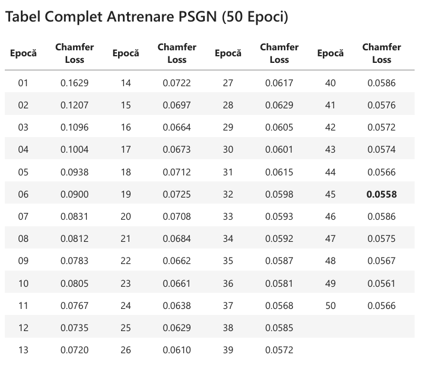

# 3D-Object-Reconstruction-AI
AI Project: 3D Object Reconstruction using Discrete Neural Representations (Point Set Generation Network) on Pix3D.

## 1. Project Overview
The 3D reconstruction of objects from 2D images is a fundamental problem in Computer Vision, most frequently encountered in Virtual Reality (VR) and robotics. The main objective of this project is to transpose visual information from a two-dimensional plane into a three-dimensional representation, specifically as a **Point Cloud**. 

This project implements the **Single-View PSGN (Point Set Generation Network)** approach, generating a point cloud based on a single RGB image input.

## 2. Literature Review & References
To establish the technical foundation of the approach, I studied the following State-of-the-Art research papers:

* **Jin, Y., Jiang, D., & Cai, M. (2020). *3D reconstruction using deep learning: a survey.***
  * Provides a comprehensive overview of modern 3D reconstruction methods based on Deep Learning.
  * Highlights the major advantage of point clouds compared to dense voxels: increased efficiency due to flexibility and a significantly lower computational cost, successfully eliminating resolution artifacts specific to volumetric discretization.
* **Fan, H., Su, H., & Guibas, L. (2017). *A Point Set Generation Network for 3D Object Reconstruction from a Single Image.***
  * A pioneering work that proposes a neural architecture capable of directly inferring and generating 3D structures as unordered point clouds from a single 2D image.
  * Solves the visual occlusion problem through a predictive Encoder-Decoder architecture and introduces spatial metrics such as **Chamfer Distance (CD)** to handle unordered datasets.

## 3. Dataset (Pix3D Data)
The model was trained and evaluated using the **Pix3D Dataset** (http://pix3d.csail.mit.edu/data/pix3d.zip), which provides a precise correspondence between 2D input images and real-world 3D models (Ground Truth).

**Data Preprocessing:**
To use this dataset effectively and facilitate model convergence, the raw 3D files (`.ply` or `.obj`) were subjected to a rigorous spatial preprocessing algorithm:
1. **Sampling:** Standardizing the point clouds to a fixed size of $N=2048$ points (via random downsampling or upsampling).
2. **Centering:** Moving the centroid of the point cloud exactly to the origin of the coordinate system (0, 0, 0) to ensure translation invariance.
3. **Scaling (Spherical Normalization):** Forcing the entire point cloud to fit perfectly within a unit sphere (radius = 1) by dividing all coordinates by the maximum Euclidean distance.

## 4. PSGN Architecture (Point Set Generation Network)

### The Problem It Solves
This method addresses a fundamentally ill-posed problem: due to the lack of depth information and severe occlusion (the back of the object is invisible), the network must use learned priors to "imagine" the complete geometry of the object.

### Point Clouds vs. Voxels
We chose point clouds over volumetric representations (voxels) for several technical advantages:
* They are a simple and uniform structure that does not require encoding complex combinatorial patterns (like meshes).
* They avoid quantization artifacts specific to voxels.
* They preserve the thin structures of objects significantly better than voxel-based networks.

### Network Components
The implemented architecture is a feed-forward predictive model consisting of two main components:
1. **The Encoder:** Utilizes a pre-trained convolutional network (**ResNet18**) with the final classification layer removed. It extracts a dense feature vector representing the visual essence of the 2D projection.
2. **The Predictor (Decoder):** Implemented as a branch with **Fully-Connected** layers. It transforms the latent vector into an output matrix of size `(N, 3)`, where $N=2048$ (the generated points) and 3 represents the `(x, y, z)` coordinates. A `Tanh` activation function is applied at the end to limit the output coordinates to the `[-1, 1]` range.

### Loss Function: Chamfer Distance (CD)
Since the points represent an unordered set, I implemented the **Chamfer Distance (CD)** as our spatial metric. CD measures the similarity between the generated point set and the Ground Truth point set by calculating the average distance of each point to its nearest neighbor in the other set. It is continuously differentiable and highly efficient to parallelize on GPUs.

## 5. Results and Visualizations

The optimization process was highly stable. By analyzing the training history, the model minimized the Chamfer Loss from an initial threshold of `0.1629` to a final value of `0.0566`, reaching the optimal point of `0.0558` at epoch 45.

*(See the loss evolution chart below)*

> **Figure 1:** The evolution of the Chamfer Loss over 50 epochs. The lowest error (0.0558) was achieved at Epoch 45.

Visually, the model successfully captures the general volumetry of the objects (e.g., the length of chair legs or the width of a table).

> **Figure 2:** Comparison from left to right: 1. Network Input (2D Image) | 2. AI Prediction (3D Point Cloud) | 3. Ground Truth (Pix3D).

## 6. Conclusions & Performance Analysis

Following the implementation and training of the PSGN model, we draw the following technical conclusions:
* **Computational Efficiency:** The discrete representation is highly efficient ($\mathcal{O}(N)$ memory complexity). The model generates 1024/2048 point sets almost instantaneously during inference (~10-50 ms), making it ideal for real-time applications.
* **Geometric Fidelity:** The network successfully learns correct spatial coordinates directly from the ResNet features and estimates volume and depth excellently.
* **Identified Limitations:** The main disadvantage is the lack of point connectivity. Because the network predicts independent points, there is no surface continuity guarantee. Highly complex or perfectly flat surfaces can appear slightly "noisy" or fragmented, requiring advanced post-processing if a watertight mesh is desired.
